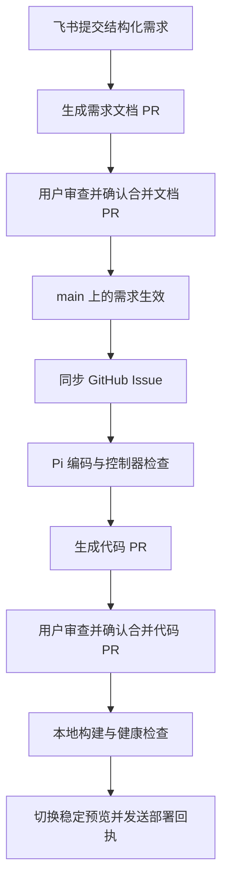

# Spec Loop

<p align="center">
  <picture>
    <source media="(prefers-color-scheme: dark)" srcset="docs/assets/brand-v1/lockup/horizontal-dark.png">
    
  </picture>
</p>

Spec Loop 是一个以需求文档驱动的 AI 开发工作流：连接需求、代码、审查与部署，让人掌握每一次合并。当前以本地运行的计数器 Demo 验证这套方式。

[查看计数器演示](https://spec-loop-three.vercel.app/)（需 Vercel 账号登录） · [快速启动](#快速启动) · [文档导航](#文档导航)

## 文档是第一公民

> 文档是开发的起点，也是持续维护的产品契约。
>
> 以文档定义需求，以验证确认交付，让每一次变更都有据可循。

需求、边界和验收标准先写进文档，经过审查进入 `main` 后，再驱动任务与实现。已生效的 `docs/specs/*.md` 是前端产品行为的唯一权威来源。聊天用于表达意图，Issue 和 PR 记录执行过程；它们不能自行改变已经生效的产品契约。

不同问题有各自的权威来源：

| 问题 | 权威来源 |
| --- | --- |
| 产品应该怎样工作？ | GitHub `origin/main` 上已生效的 `docs/specs/*.md`；当前约束前端产品行为 |
| 为什么这样设计？ | 已确认的设计决策及理由；草案应明确标注 |
| 代码实际实现了什么？ | 对应提交的源码、测试与验收证据 |
| 当前发布了什么？ | 实际部署版本、健康检查与部署回执；本地和 Vercel 分别核对 |

文档也可能存在错误、歧义或遗漏，需要通过审查和版本变更修正。需求已生效，不代表代码已实现或已经部署；实现偏离需求时应记录缺陷，不能为了让检查通过而擅自弱化契约。

这些受版本管理的文档与交付证据，可以成为可靠知识库的基础。后续知识库应引用原始来源和版本，区分“已规定、已实现、已验证、已发布”；搜索索引与摘要作为可重建的派生内容维护。**知识库检索与持续一致性校验属于后续建设方向，当前 Demo 尚未提供这些能力。**

## 一次需求如何交付



完成飞书配置并启动控制器后，在绑定会话发送：

```text
需求：在计数器页面增加“翻倍”按钮，点击后把当前值乘以 2。
```

也可以使用 `/require 描述`。描述长度为 1～2000 字符，首版只更新 `docs/specs/counter.md` 中现有的 `REQ-CNT-01`。文档 PR 与代码 PR 分别由用户审查并显式确认合并；可在 GitHub 网页人工执行，也可在受控飞书入口启用后，由绑定会话中的白名单用户预检并二次确认。模型和控制器不得自主合并。

发送 `状态` 查看请求阶段与 PR 链接；需求请求失败后，使用 `重试需求 <请求ID>` 恢复未完成阶段。代码 Issue 的失败重试使用 `重试 #<Issue编号>`，两者不能混用。命令、权限与恢复说明见 [飞书配置](docs/development/feishu-setup.md)。

## 当前范围与运行方式

| 范围 | 说明 |
| --- | --- |
| 文档驱动开发 | 已生效需求同步为 Issue，Pi Worker 生成只修改 `src/**` 的代码 PR |
| 飞书入口 | 单一绑定会话、白名单操作者；支持结构化需求、通知、状态和显式重试 |
| 用户确认合并后部署 | 控制器构建对应主线版本，健康检查通过后切换本地预览 |
| 运行规模 | 单仓库、单操作者、单 Pi 作业；同需求最多一个活动交付 |
| 后续范围 | 错误自愈（闭环 B）、Triage、普通闲聊、多轮澄清编辑，以及飞书写入其他需求块或文档均暂缓 |

飞书受控确认合并的实现已进入 `main`；使用该入口前，仍需重启控制器加载对应版本并完成验收。适用 PR、身份绑定、确认码和失败恢复见 [飞书受控确认合并 PR](docs/development/feishu-merge-plan.md)。

控制器、Pi Worker 和飞书长连接运行在本机。Vercel 独立发布由 `dist/` 生成的静态前端，Ready 只代表静态站部署成功；它不能证明本地链路或相同 SHA 的发布已经完成。电脑关机后，已发布的静态站仍可访问，本地编码、预览和飞书响应会停止。

阶段 1～4 的真实验收记录见 [启动与验收指南](docs/development/demo-runbook.md#9-验收记录)，结构化入口的验收要求见 [飞书需求入口计划](docs/development/feishu-intake-plan.md#6-验收要求与证据)。源码存在、测试通过与真实链路验收分别记录，能力以已部署版本及对应验收证据为准。

## 快速启动

运行环境为 **Node 24、macOS**，Agent 隔离依赖 `sandbox-exec`；隔离不可用时拒绝运行 Agent。准备 Git、已认证的 GitHub CLI、可调用的 Pi 模型，以及需要接入飞书时的应用配置。完整配置见 [启动与验收指南](docs/development/demo-runbook.md)。

在仓库根目录执行；更新前先确认已有本地修改已妥善保留：

```bash
git status --short --branch
git fetch origin
git switch main
git pull --ff-only origin main
npm ci
cp -n .env.example .env.local
chmod 600 .env.local
# 编辑 .env.local 后再执行：
export SPEC_LOOP_ENV_FILE="$PWD/.env.local"
npm run demo:init
npm run demo
```

不要提交 `.env.local`、原始秘密、运行缓存或 `.review/`。`demo:init` 失败时先按指南排障，不继续启动或把旧预览当作本轮成功。

| 本地地址 | 用途 |
| --- | --- |
| `http://127.0.0.1:4000` | 控制 API，由 `npm run demo` 启动 |
| `http://127.0.0.1:5173` | 稳定预览，需要 `demo:init` 成功构建并写入健康发布指针 |
| `http://127.0.0.1:5174` | Vite 开发页，另开终端运行 `npm run dev` |

## 交付保障

- 需求文档只有进入 GitHub `origin/main` 后才生效；本地文件、本地 commit 和未合并 PR 都不改变现行需求。
- `spec-author` 只输出 `{summary, content}`，不能调用工具或直接写仓库；控制器只允许写入 `docs/specs/counter.md`，并校验现有 `REQ-CNT-01` 保留且确有变化。
- Planner 只计划，Worker 只请求修改 `src/**`；类型检查、测试、构建、Git 与 GitHub 操作由控制器执行。
- 每次业务需求的文档 PR 和代码 PR 都必须由绑定会话中的白名单用户显式确认合并；可通过受控飞书入口执行，也可在 GitHub 网页人工执行。任何 Agent 和控制器都不得未经确认自主 Merge。
- 子进程使用环境白名单；Pi 不获得 GitHub 凭据，测试与构建不获得 GitHub 或模型凭据。
- 飞书 `messageId` 持久去重；同一 `counter.md` 目标只允许一个未结束请求或 PR。主线漂移或远端状态不明时停止处理；失败恢复需要显式重试。
- 发布前核对需求版本，旧需求对应的交付不能记为当前版本完成。
- Issue 因 `Closes #N` 关闭不代表部署完成；只有对应主线版本通过本地健康部署，才记录 `status:done` 与部署回执。Vercel 发布需独立核对。
- 部署失败保留旧预览并只执行 `deploy-only`；需求入口按已落盘阶段恢复，已有有效文档/commit/PR 不重复生成。既有 Planner/Worker 的更细阶段恢复仍按各自契约验收。
- 飞书通知失败不得打断 GitHub 主链路。

## 文档导航

| 文档 | 用途 |
| --- | --- |
| [计数器需求](docs/specs/counter.md) | 产品行为契约；以 GitHub `origin/main` 版本为准 |
| [启动与验收](docs/development/demo-runbook.md) | 环境配置、运行命令、恢复操作与历史验收 |
| [飞书配置](docs/development/feishu-setup.md) | 应用权限、绑定会话、需求命令与重试 |
| [飞书需求入口计划](docs/development/feishu-intake-plan.md) | 入口范围、阶段恢复与验收要求 |
| [飞书受控确认合并 PR](docs/development/feishu-merge-plan.md) | 用户预检、二次确认、受管 PR 边界与恢复 |
| [Vercel 静态前端](docs/development/vercel-setup.md) | 静态站配置与云端发布边界 |
| [需求与验收](docs/development/requirements.md) | 编排系统的需求与验收设计，含后置范围 |
| [架构与运行契约](docs/development/architecture.md) | 角色隔离、版本管理与故障恢复设计，含目标设计 |

`docs/development/` 用于工程设计与维护，不参与产品需求扫描；其中草案和目标设计不能代替实际验收结果。

## 品牌素材

<p align="center">
  <picture>
    <source media="(prefers-color-scheme: dark)" srcset="docs/assets/brand-v1/motion/logo-loop-dark.gif">
    
  </picture>
</p>

[Logo、Icon 与套图](docs/assets/brand-v1/README.md) · [动图 GIF](docs/assets/brand-v1/motion/logo-loop-light.gif) · [下载完整素材包](docs/assets/spec-loop-brand-kit-v1.zip)
