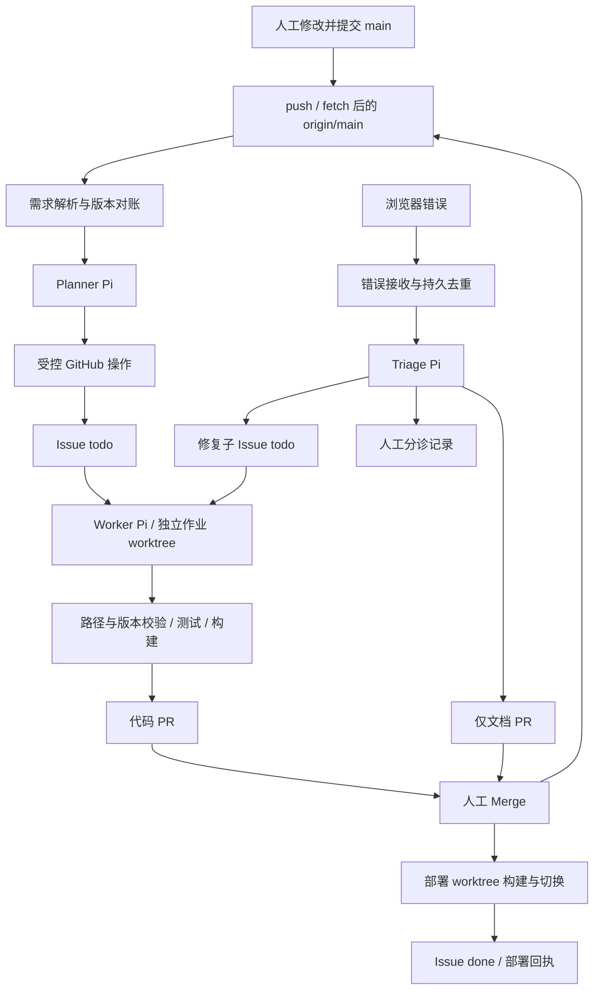

# 架构与运行契约

文档日期：2026-11-14。状态：开发设计草案，待实施。产品目标及范围以 [需求与验收](requirements.md) 为准。

## 1. 推荐方案与取舍

| 事项 | MVP 建议 | 取舍理由 |
| --- | --- | --- |
| 应用 | Vite + 原生 HTML/TypeScript | 足够演示错误捕获，减少 React 等依赖 |
| 守护进程 | Node.js + TypeScript，HTTP、子进程、文件与测试使用 Node 原生能力 | 无数据库、队列服务或 Web 框架；保留少量开发依赖 |
| 触发 | 本地变更监听 + 5 秒远端/状态轮询，失败退避 | 保存、commit、远程 Merge 都可补偿，不把文件系统事件当事实 |
| 并发 | 全局 1 个 Pi 作业，另有 REQ/Issue 锁及部署锁 | 降低演示仓库的重叠改动与冲突，之后再放开并发 |
| GitHub 写入 | Agent 受控工具调用 → 编排器校验 → gh 执行并回读 | 保留真实 GitHub 状态，同时限制仓库、路径与动作 |
| 运行目录 | 人工 checkout、作业 worktree、部署 worktree 分离 | 不切换用户当前分支，不覆盖未提交内容 |
| Pi 隔离 | 只显式加载受信角色工具；独立配置目录；系统级文件权限边界 | Prompt 负责约束意图，执行层负责阻断越权 |
| 状态 | GitHub 业务状态 + 原子写本地 JSON 日志/游标 | 适合单机 MVP；不宣称跨机器 exactly-once |

“零重型依赖”不等于零依赖：预计使用 Vite、TypeScript、轻量 TS 运行器和固定版本 Pi 包。无需数据库、Redis、Docker 或服务器框架。隔离能力不可用时停止启动，不静默降级为仅靠 Prompt。

## 2. 总体数据流



编排器拥有 git/gh 权限，Agent 只获得角色所需的能力。图中的工具调用必须带作业身份、目标仓库、REQ-ID 和需求哈希；模型返回任意文本不等于已执行成功。

## 3. 进程、模块与职责

| 模块 | 职责 |
| --- | --- |
| `index.ts` | 启停、单实例锁、监听/轮询、信号处理、顺序调度 |
| `specs.ts` | 从 Git 快照解析需求、验证锚点、生成哈希与差量 |
| `reconciler.ts` | Planner 输入、幂等操作计划、游标推进、旧版本取消 |
| `github.ts` | gh argv 调用、分页、元数据、受管标签转换、回读确认 |
| `git.ts` | 基线捕获、受限 push、worktree、分支、允许路径提交 |
| `state.ts` | 持久队列、锁、操作日志、原子写、重启恢复 |
| `scheduler.ts` | todo 抢占、REQ/Issue 串行、版本检查、失败与重试 |
| `pi-runner.ts` | 无头启动、角色工具、超时、进程组终止、输出与日志 |
| `extensions/role-tools.ts` | 唯一显式加载的受信扩展，向控制器申请受限动作 |
| `sandbox.ts` | Pi 与验证子进程的系统级隔离适配和启动探针 |
| `error-server.ts` | 回环 HTTP、校验、去重、持久入队、状态接口 |
| `triage.ts` | 错误版本核验、分类校验、文档 PR 或修复任务 |
| `deploy.ts` | 合并发现、构建、预览版本切换、健康检查、部署回执 |
| `log.ts` | 彩色阶段前缀、结构化事件、脱敏、输出截断 |

不把所有逻辑塞进 `index.ts`。公共模块不意味着引入大型架构框架，模块边界主要用于独立验证恢复与权限行为。

## 4. Agent 权限与物理隔离

### 4.1 角色能力表

| 角色 | 可读 | 可请求写入 | 明确禁止 |
| --- | --- | --- | --- |
| Planner | 捕获的 specs 快照、diff、受管 Issue/PR 摘要 | 当前仓库受管 Issue 内容/标签/评论/开关状态；按规则作废旧 PR | 任意仓内文件写入、任意 shell、代码 PR |
| Worker | 当前需求快照、必要 `src/`、只读构建配置及测试说明 | 当前作业 `src/`；固定验证；请求发布代码 PR | docs、package/lock、orchestrator、任意 git/gh/shell |
| Triage | 现行 specs、匹配部署 SHA 的 src、脱敏错误、已有记录 | 当前需求的 docs 补丁；请求文档 PR或修复子 Issue | src 写入、自动 Merge、无依据扩展产品功能 |
| Controller | 必要仓库与运行状态 | 校验后执行 git/gh、切换预览 | 自行发明产品需求、接受任意模型 shell 命令 |

主 Issue 不作为第二份需求：正文展示来源路径、哈希、SHA 和派生验收摘要。Worker 每次以捕获的文档为准；两者不一致时先对账，再调度。

### 4.2 执行边界

采用四层边界，任何一层都不单独宣称完成隔离：

1. **角色 Prompt**：明确数据来源、路径、允许动作、输出 schema 和停止条件。
2. **工具边界**：禁用内置 bash/read/write/edit 及自动发现的扩展、MCP、skills、模板与上下文文件。只显式加载本仓库固定版本的角色扩展，且只启用该角色工具。
3. **物理边界**：Pi 在隔离输入目录运行，只读访问按需复制的快照、提示词和运行时；可写区域限作业临时输出/必要缓存。人工 checkout、其他 worktree、`.git`、gh 凭据和宿主敏感目录不可写，也不暴露给工具。
4. **发布边界**：控制器按 canonical path、真实父目录、symlink 与文件类型检查所有补丁；发布前枚举 tracked/untracked 差异、检查全部允许路径、固定输入哈希和需求版本。

工具调用通过每作业专属的受限 IPC 通道提交给控制器。通道绑定作业 ID、角色、目标 worktree 和动作白名单；不接受模型提供仓库地址、任意 shell 字符串或随意切换目标目录。GitHub 凭据始终留在控制器，Pi 只得到预先脱敏的业务数据。

Worker 的写工具只能请求 `src/**`，Triage 只能请求指定 `docs/specs/*.md` 需求块；禁止路径穿越、绝对路径、symlink、特殊文件和通过 `.git` 间接写入。Planner 根本没有文件写工具。

验证进程也必须受隔离：运行测试会执行 Agent 写入的源代码。构建使用主线固定的 package/config/lock，不允许访问 gh 凭据和其他工作区；构建产物写入隔离输出区。不得把“只给固定 npm 命令”误认为执行代码没有权限风险。

`src/` 内的行为测试可由 Worker 随功能修改，但不能作为唯一验收。`tests/` 中受控的关键验收及权限/状态机探针不开放给 Worker 修改；删除断言或弱化测试不能替代满足需求。独立评审核对实现与文档行为，防止仅靠可被 Agent 修改的测试宣称通过。

首个目标平台为当前 macOS，优先验证系统 `sandbox-exec` 适配；Linux 可使用 bubblewrap 适配，但不纳入本轮 macOS 现场演示的必需依赖。当前仅确认宿主存在 `/usr/bin/sandbox-exec`，没有验证隔离配置可用。实现必须先证明越权写入失败、合法工具与模型请求可用；无法证明时报告阻塞，不宣称满足物理隔离。

不使用 `chmod`、worktree 或 symlink 假装系统权限隔离；同一用户拥有的文件可被改回权限，worktree 也会共享 Git 元数据。

### 4.3 Pi 启动契约

每个作业使用 `pi -p`、固定角色 System Prompt、独立配置/会话目录和明确的 provider/model。禁用资源自动发现，不读取用户目录中的任意插件或仓库上下文。全局 `AGENTS.md` 中需要的规则由控制器显式注入；禁用上下文发现不代表丢弃规则。

官方当前 CLI 支持 `--no-extensions`、显式 `-e`、`--no-skills`、`--no-prompt-templates`、`--no-context-files`、`--no-mcp`、`--no-session` 及 `--tools`。这些选项必须按锁定版本和 `pi --help` 验证；不能把 `--no-tools` 与需要启用的自定义工具混用后假设工具仍可调用。

特别注意：当前文档说明普通 `--tools` 选择不一定移除 MCP 能力，必须显式关闭 MCP，并证明仅有角色白名单工具可达。扩展以 Pi 进程权限执行，因此只加载受信扩展。

- 角色最大总耗时默认 300 秒；包括多轮工具调用，不是每轮重新计时。
- 使用 argv 数组和 `shell: false`，大输入经 stdin 或受控文件传递；不把需求、错误堆栈或模型输出拼接进 shell。
- 超时或取消先终止进程组，宽限 5 秒后强杀；确认无后代写入后才释放锁。
- 捕获 stdout/stderr、退出码、耗时和工具审计；最终角色结果必须通过 schema 验证。
- 非零退出、结果缺失、无效 JSON、`needs-human`、工具拒绝、构建失败均视为业务失败；退出码 0 不等于任务完成。
- 单作业日志设大小上限，摘要默认最多 4 KiB；完整脱敏日志仅在本地保留默认 7 天。
- 不把 API key 放命令行或日志。模型身份和版本由配置与运行记录核对，不自动切换 provider/model。

## 5. Git 与需求对账

### 5.1 人工工作区与主线

人工 checkout 只被观察，不执行自动 stash、reset、checkout 或 rebase。所有生成变更在专属 worktree 完成。

远端仓库通过实施时的 `demo:init` 确认：必须有 `origin`、明确的 `owner/repo`、可访问的 `main`，且 `main` 是默认分支，保证 `Closes` 行为与设计一致。不从文件夹名称推断仓库，也不自动创建任意远端仓库。

本地 `main` 新提交的自动推送条件：

1. 已 fetch 并钉住远端 SHA；本地相对该 SHA 是纯快进。
2. 待推送提交只包含 `docs/specs/*.md`，工作区相关内容无未提交修改。
3. 提交内容已通过需求解析，仓库绑定一致。
4. 仅执行普通 push；远端推进导致拒绝时重新 fetch，不 force push，不代替用户解决分叉。

若待推送包含产品代码、其他配置或非快进历史，只提示人工 push/整理；远端有效提交仍可照常对账。不自动 commit 用户的文件保存。

### 5.2 对账顺序

1. 获取对账锁，fetch 并捕获本轮固定 `targetMainSha`。
2. 从 Git 对象读取前后需求全量快照，严格解析；提取 diff 用于 Planner 解释。
3. 若没有有效旧游标，走全量 bootstrap；历史重写导致旧 SHA 不可用时显式记录并做全量对账，不猜测“所有需求都删了”。
4. 读取所有受管 Open/Closed Issues 与已知 PR，按元数据映射，不能只靠标题搜索。
5. 确定性计算 add/update/remove/move；Planner 负责派生任务描述与理由，不能改变确定性 ID 差量或凭空创建需求。
6. 逐项记录操作意图、调用 gh、回读结果，成功后提交该操作记录。
7. 全部操作确认后推进快照游标；中途失败下次重放，依靠操作键与远端元数据去重。
8. 如果期间主线又推进，结束本轮后立即处理下一快照；不在一个事务中混用两个版本。

正常人工或机器人提交均按内容对账。防重复依据“已处理 SHA + 需求哈希 + 操作键”，不是作者名、`[bot]` 或提交消息。尤其不能跳过 Triage 文档 PR 的合并提交。

## 6. GitHub 契约

### 6.1 标签

必须初始化：`pi-task`、`status:todo`、`status:processing`、`status:in-review`、`status:done`、`status:failed`、`spec-patch`。

控制器只移除自己管理的上述 `status:*` 集合，保留其他标签。受管 Issue 同时只能有一个该集合内状态；标签变更使用一次 Issue 更新请求并回读确认。`spec-patch` 标在文档 PR 上。

| 状态 | 含义 | 下一动作 |
| --- | --- | --- |
| todo | 有效需求/修复等待执行 | 获取锁、核对版本、启动 Worker |
| processing | 当前作业持有锁 | 完成校验并发布 PR，或失败 |
| in-review | 代码 PR 等待人工决定，或已 Merge 等待部署 | 轮询 PR、执行部署 |
| done | 当前任务目标版本部署成功 | 仅新需求版本或新修复另行调度 |
| failed | 规划、分诊、实现、发布或部署失败 | 按元数据区分恢复动作，不自动改成 todo |

需求删除的关闭 Issue 不伪装成 done：清理活动状态，记录 `lifecycle: removed` 和关单原因。人工关闭没有 Merge 的 PR 记录 `review-rejected`，停在 failed，等待显式重试或新需求版本。

### 6.2 受管元数据

在 Issue/PR Body 中保留版本化的机器区块；人工说明放在区块外，更新时保留。字段示意：

```json
{
  "schema": 1,
  "system": "spec-loop",
  "kind": "requirement",
  "reqId": "REQ-CNT-01",
  "specPath": "docs/specs/counter.md",
  "specHash": "<sha256>",
  "sourceMainSha": "<git-sha>",
  "operationKey": "<deterministic-key>"
}
```

区块用固定 HTML 注释边界包围。`kind` 区分 requirement、repair、triage、spec-patch、code-pr；修复任务增加 `parentIssue`、`errorFingerprint`；作业增加 `jobId`、`attempt`；失败增加 `failureStage`、`resumeAction`。评论也带操作键，用于“请求成功但本地未记账”的恢复查重。

元数据是索引，不是独立需求副本。校验 schema、REQ 是否存在、PR base/head/变更路径与源版本；复制一段受管标记并不能绕过这些检查。

主 Issue 唯一键为 `repo + reqId`；版本操作键包括 `specHash + action`。修复唯一键为 `reqId + specHash + errorFingerprint + repair`。同一 REQ 下主任务与修复任务争用同一个需求锁。

### 6.3 gh 调用与数据完整性

初始需求中的 `gh issue list --json number,title,body` 作为最低输入，还需读取 `state`、`labels`、`url` 等字段。默认列表有数量上限，不能仅提高 `--limit` 就宣称支持任意规模；适配器必须分页，例如通过 `gh api --paginate` 完整读取受管集合并过滤 PR 对象。

所有操作显式指定绑定仓库。多行正文写到临时文件，使用 `--body-file`；不通过 shell 插值传需求内容。gh 超时默认 30 秒，网络/限流最多 3 次退避重试；鉴权失败不盲目重试。

受管 PR 可以按 [飞书受控确认合并 PR](feishu-merge-plan.md) 由绑定会话中的白名单用户预检并二次确认。控制器只执行用户确认的同步 SHA 锁定 Merge，不得自主发起、自动重发或绕过分支保护；合并结果仍需回读和远端对账。

创建类请求返回不确定结果时，先按操作键查询再重试，避免重复 Issue/PR。gh 不可用时，本地标记待同步并打印明显告警，恢复后补发失败状态与评论；不能声称本次失败已经同步到 GitHub。

不假设 GitHub label 是分布式锁。MVP 只保证一个本地实例写入；另一个机器也启动控制器属于明确不支持的部署方式。

## 7. 调度、过期任务与恢复

### 7.1 本地状态

`.orchestrator-state.json` 记录：schemaVersion、repo、对账游标、需求/Issue 索引、活动作业、操作日志、错误收件箱、部署游标与待同步通知。通过“同目录临时文件 → 完整写入/刷盘 → rename”原子替换，保留上一份有效备份；禁止覆盖其他 repo 的状态。

状态文件、锁、worktree、release、日志、模型凭据全部加入忽略规则。它们不是 `docs/specs/` 的组成部分。

运行时布局建议：

```text
.orchestrator-state.json
.orchestrator/
  daemon.lock
  jobs/<job-id>/             # 输入、结果、每作业 IPC 与隔离缓存
  worktrees/<job-id>/        # 控制器管理的代码/文档 worktree
  deploy-worktree/           # 固定 SHA 的部署工作树
  releases/<sha>/            # 不可变构建产物
  logs/<job-id>.jsonl
```

这些路径都只能是配置后的仓库内专用根，清理前校验 canonical path、所属作业和 Git 集成情况。失败作业与未发布改动保留用于诊断，不自动丢弃。

### 7.2 锁

- 守护进程使用原子排他创建的单实例锁，记录 PID、进程启动标识与随机实例 ID。
- 同进程内维护 REQ 锁、Issue 锁、全局 Pi 信号量、对账锁和部署锁。
- 重启时核验旧实例及其后代，PID 相同不能单独证明是同一进程；失效租约也不能证明旧 Pi 已停止。
- 只在确认旧写入者停止后回收作业。无法确认时停止相关任务并输出恢复步骤，不启动第二个写入者。
- 优雅退出停止接单、终止当前作业、落盘、最后释放单实例锁。

### 7.3 需求变化与发布竞态

新需求哈希到达时，标记旧作业过期并取消。Worker 校验前、提交前、push 前、创建 PR 前均核对需求仍是目标版本。新版本到达时即使旧模型返回成功，也不得发布为当前有效交付。

发布前还需确认任务涉及的 `src/` 路径没有在主线发生冲突性变化。演示默认串行执行；已有 PR 冲突不自动强推/重写，记录失败并从新主线显式重跑。

PR Merge 仍存在人工窗口，无法靠本地轮询彻底防止误合并过期 PR。系统负责尽快关闭旧 PR、在部署/关单时再核对需求版本；不能将旧版本 Merge 误记为新版本 done。

`already-satisfied` 属于无代码发布的完成分支，不创建空 PR。控制器必须用当前需求版本的固定验收、构建和同 SHA 部署健康证据确认；证据充分时写去重回执并标 done，否则转人工检查，不能停留在 processing 或伪造 Merge 记录。

### 7.4 重启恢复

| 崩溃位置 | 恢复策略 |
| --- | --- |
| 已创建 Issue，游标未写回 | 远端操作键命中，回填本地，不重复创建 |
| 已改 processing，Pi 未启动或已退出 | 核验旧进程后标 interrupted/failed，按预算允许显式重试 |
| 已 push，未创建 PR | 校验远端分支及作业提交，复用分支创建 PR |
| PR 已创建，Issue 标签未更新 | 按操作键查到 PR，补到 in-review |
| 已 Merge，守护进程停机 | 扫描受管合并记录，按当前远端主线构建并记录覆盖的 PR |
| 预览已切换，评论未发布 | 健康检查与运行 SHA 一致后补回执，不重复部署 |
| 本地状态损坏或丢失 | 从备份恢复或进入显式 recover，重建 GitHub 索引；需求有歧义时不自动关单 |

不得在启动时把全部 processing 一律改回 todo，也不得把 failed 全量重新执行。

## 8. HTTP 与浏览器错误契约

### 8.1 请求示例

```json
{
  "schemaVersion": 1,
  "reportId": "<browser-generated-id>",
  "reqId": "REQ-CNT-01",
  "name": "CounterInputError",
  "message": "step is empty",
  "stack": "<sanitized-stack>",
  "page": "/",
  "appVersion": "<deployed-main-sha>",
  "occurredAt": "<ISO-8601>"
}
```

`reqId` 允许缺失但不能盲目信任；Triage 根据文档和代码核对归属。客户端时间仅为线索，队列使用服务端接收时间。剥离 URL 查询参数、表单原始值、token 和用户输入中的敏感信息。

### 8.2 接口行为

| 接口/状态 | 契约 |
| --- | --- |
| `POST /api/error-report` | JSON；最大 64 KiB；消息 2 KiB，堆栈 16 KiB；严格字段与长度校验 |
| `202` | 已持久接收或命中去重；返回 reportId、fingerprint、duplicate；不代表修复完成 |
| `400 / 413 / 415` | schema 不合法、请求过大或 Content-Type 不支持 |
| `403 / 429` | Origin/实例 token 不符或超过本机限流 |
| `503` | 队列满或落盘失败，不能假装已接收 |
| `GET /api/health` | 进程存活、GitHub 最近同步结果、队列摘要；不输出秘密 |
| `GET /api/status` | 演示所需 REQ/Issue/PR/部署状态，只读，不提供任意命令执行 |

默认只绑定 `127.0.0.1:4000`，前端为 `127.0.0.1:5173`；统一 host，避免 localhost/IPv6 混用。仅允许配置的本地 Origin，处理 OPTIONS，不使用任意来源 CORS。

每次演示实例生成独立短期上报 token，由本地服务向允许的前端会话提供，不提交 Git。限制为每分钟 30 次、队列最多 100 条；健康/状态接口无需把 token 暴露到 URL。此机制是本机成本控制，不宣称抵御同机恶意进程。

前端对同一错误的边界捕获与全局事件去重，每次最多重试一次；服务器是持久去重的最终裁决方。新版本相同错误允许再次上报，但自动修订链预算仍继承。

## 9. Triage 的证据与输出

输入由控制器固定：脱敏错误、部署 SHA、该部署的代码、现行需求及其哈希、关联 Issue/PR。不能把当前工作区代码当作报错版本。

输出必须包含分类、REQ-ID、引用的条款/文件位置、解释、置信说明，以及以下二者之一：

- `spec-gap`：当前块哈希、局部补丁、原合法验收条款保留检查、新边界候选、复现证据。
- `implementation-gap`：违反的明确条款、复现步骤、预期/实际结果；不携带文档修改。

无法引用证据或补丁删除/弱化既有需求时拒绝输出并进入 needs-human。控制器不让 Triage 改写全篇需求，也不允许把已有的失败验收删除掉。

创建文档 PR 使用 `pi/spec-<req>-<fingerprint8>`，必须带 `spec-patch` 标签，Body 中使用 `Related to #N`，不能包含 `Closes` 主需求或修复任务。文档 Merge 只使需求生效，不等于错误已修复。

## 10. 部署与完成语义

### 10.1 部署流程

1. 验证 PR 已 Merge 到绑定仓库的 `main`，受管元数据、分支和最终文件范围一致。
2. fetch 后捕获最新远端主线 SHA，并验证待处理合并提交在其历史中；合并/squash/rebase 的实际结果以 GitHub 返回与 Git 图为准。
3. 若同一轮发现多次合并，构建一个包含这些合并的主线快照，在每个相关任务回执中说明“PR 合并 SHA”和“实际部署 SHA”。
4. 在独立部署 worktree 使用主线可信的 lock/config，运行类型检查、测试和 `npm run build`，输出到 `.orchestrator/releases/<sha>/`。
5. 由守护进程自带的轻量静态服务预检候选产物，再将活动 release 指针原子切换到新目录。
6. `GET /__version` 与页面返回的版本必须一致，执行最小浏览器/HTTP 冒烟；失败则切回旧 release。
7. 成功后持久保存部署位置，发布去重回执，更新 done/关单；若需求已更新，不覆盖最新任务状态。

演示运行使用稳定端口 `5173` 的正式预览服务；Vite dev server 仅用于人工开发，端口 `5174`。避免把 HMR 当部署：Worker worktree 里的修改不能在人工 Merge 前改变正在演示的页面。

页面轮询 `/__version`，发现新版本后刷新一次或提示刷新。版本 SHA 通过构建时注入，不执行读取 git/gh 的浏览器逻辑。

### 10.2 失败恢复

保留上一个可用 release，部署失败不得先停掉旧服务。Issue 的 `failureStage=deploy`、`resumeAction=deploy-only`；即使 GitHub 已因 `Closes` 自动关单，也重新打开并标 failed，后续只重试构建/部署。

旧 PR 对应需求哈希若已失效，部署结果仍如实记录，但不标最新需求 done。父子任务分别核验，不因一个修复完成就顺便关闭所有相关问题。

## 11. 可观测性与配置

终端阶段前缀必须包含 `[ERROR-CATCH]`、`[TRIAGE]`、`[RECONCILER]`、`[WORKER]`、`[DEPLOY]`，另提供 `[INIT]`、`[RECOVERY]`。TTY 使用 ANSI 颜色，非 TTY 或 `NO_COLOR` 关闭颜色。

每条事件记录时间、阶段、作业 ID、REQ、Issue/PR、需求哈希、主线 SHA、尝试次数、结果与耗时。长输出落本地，终端只显示摘要；GitHub 评论不上传原始完整堆栈或凭据。

| 配置 | 建议默认值 |
| --- | --- |
| 仓库 | 从已核验 origin 绑定，持久记录 owner/repo，不静默切换 |
| 主分支 | `main`，要求远端默认分支一致 |
| HTTP / 预览 / 开发端口 | `4000 / 5173 / 5174`，端口占用时启动报错 |
| 轮询周期 | 5 秒，单轮不重叠，网络故障退避至最多 60 秒 |
| Pi 总超时 | 300 秒，终止宽限 5 秒 |
| Pi 并发 / 执行尝试 | `1 / 2`，失败停止；重试须显式请求或可证明安全的恢复 |
| 错误去重窗口 / 修订链上限 | `10 分钟 / 2 轮` |
| 模型 | 各角色明确配置 provider + exact model ID，无自动回退 |
| 本地日志保留 | 默认 7 天；失败作业与未发布改动须先确认可清理 |

配置可用不含秘密的 `orchestrator.config.json`；凭据由现有 gh 登录和 Pi 授权读取，不复制进仓库。只保留配置示例，首次初始化生成运行配置，不把用户的具体账号写死。

## 12. 未验证边界与官方依据

当前目录尚未初始化 Git；未检查 gh 登录、真实仓库权限、Pi 模型调用、任何隔离 profile 或浏览器链路。本文描述的是目标实现，不能当作验收证据。

本次读取的 Pi 上游仓库已从 `badlogic/pi-mono` 重定向到 `earendil-works/pi`，查询到的主线提交为 `3e23dd9f53be214006041e1279f2dd57008f61c0`。实施时应选择并锁定已发布版本，再针对安装版本核验；不将浮动 main 直接作为稳定 API。

- [Pi CLI：无头执行、资源与工具白名单](https://github.com/earendil-works/pi/blob/3e23dd9f53be214006041e1279f2dd57008f61c0/packages/coding-agent/docs/cli.md)。
- [Pi 扩展：与进程相同的系统权限、自定义工具及事件](https://github.com/earendil-works/pi/blob/3e23dd9f53be214006041e1279f2dd57008f61c0/packages/coding-agent/docs/extensions.md)。
- [gh issue list](https://cli.github.com/manual/gh_issue_list)、[gh pr view](https://cli.github.com/manual/gh_pr_view)。
- [GitHub 关闭关键字与默认分支行为](https://docs.github.com/en/issues/tracking-your-work-with-issues/using-issues/linking-a-pull-request-to-an-issue)。
