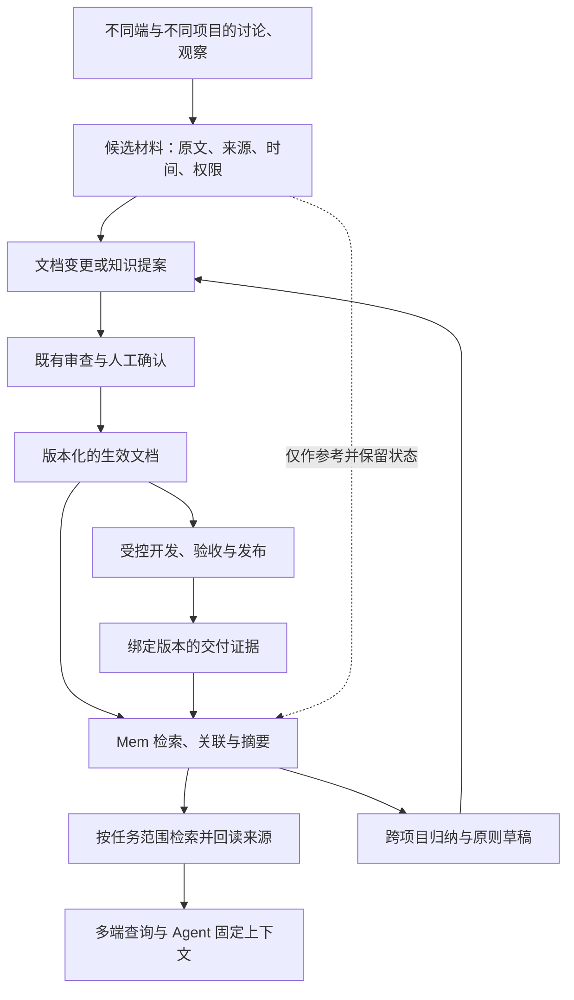

# Spec Loop 多端知识库与跨项目记忆设计评估

日期：2026-11-15。状态：设计评估草案，待讨论；本文整理两次讨论，不代表已批准接入或开发。

## 1. 目标与判断

这次讨论包含两个相连的问题：以文档为核心，能否借鉴 Nowledge Mem 从多个端收集信息，形成可靠知识库；在此基础上，能否跨项目积累经验，形成更高层次的记忆。

判断是：方向有价值，适合多端、多项目、多 Agent 的工作方式。多端采集减少背景丢失，文档治理明确哪些内容已经确认，跨项目关联帮助发现共性，经过核对的归纳才有机会成为可迁移的经验与决策原则。

推荐先使用已有的 Nowledge Mem 做检索与经验提炼，逐步完善来源、版本和证据关联。Spec Loop 继续负责受控的文档到交付流程。先验证真实任务收益，再决定需要自行建设哪些能力。

本文提出的是后续知识层设计，不扩展当前飞书入口、单仓作业、人工确认合并和角色工具权限，不启动普通闲聊、多轮澄清、Triage 或错误自愈。

## 2. 文档作为唯一信息来源应如何理解

信息可以来自聊天、会议、网页、源码、测试与运行观察。需要统一的是知识的权威入口及生效方式。

建议采用以下表述：

> 经确认、版本化的文档承载需求、决策与可复用知识；Mem 提供可追溯的检索、关联与归纳。涉及实现和发布的事实，必须引用对应版本的交付证据。

这与当前 [README](../../README.md) 的来源分工一致：

| 要回答的问题 | 应依据什么 | 不能据此直接推断什么 |
| --- | --- | --- |
| 产品应该怎样工作 | `origin/main` 上已生效的 `docs/specs/*.md` | 代码已实现、需求已验收或已经发布 |
| 为什么这样设计 | 已确认的设计决策、适用条件与取舍理由 | 草案或历史方案仍然有效 |
| 代码实际实现了什么 | 指定提交的源码及对应检查结果 | 所有环境都已部署该版本 |
| 行为是否满足需求 | 绑定需求版本、代码版本和环境的验收证据 | 部署健康就等于所有行为通过 |
| 当前发布了什么 | 实际部署版本、健康检查和部署回执 | 本地与云端处于相同版本 |
| 历史经验能否用于当前任务 | 有来源的经验文档及当前项目约束 | 通用经验可以覆盖当前任务契约 |

文档仍可能有错误、歧义和遗漏，需要审查及版本修正。证据整理成文档时应保留原始产物引用，避免仅凭一段总结认定结果正确。

Mem 中可以保留待确认材料供回顾，但查询必须显示其状态。由模型生成的摘要、关系或原则草稿，不会因为被保存、被多次检索或进入 Working Memory 就自动生效。

## 3. 借鉴 Nowledge Mem 的哪些能力

Nowledge Mem 的 Library 区分完整来源材料与提炼出的记忆，并保留原始文档或对话供回溯。这适合作为“先读来源，再保存长期结论”的参考。[官方 Library 说明](https://mem.nowledge.co/docs/library)

它的知识图谱使用 Trace、Unit、Crystal 等知识形态组织来源、知识单元与综合结论，并提供关系及演变链查询。可借鉴的是分层和追溯方式，不必直接照搬其全部数据模型。[官方知识图谱说明](https://mem.nowledge.co/docs/knowledge-graph)

| 可借鉴的能力 | 对 Spec Loop 和多项目工作的价值 | 需要我们另外保证的部分 |
| --- | --- | --- |
| 多端保留上下文 | 换工具、模型或会话后恢复背景 | 各端真实读写、来源身份与权限验证 |
| 来源检索与引用 | 找到原始需求、决策和历史讨论 | 引用对应版本，核对是否仍然生效 |
| 事实、决策与经验提炼 | 减少反复解释背景，保留设计理由 | 区分用户决定、模型建议和实测结果 |
| 关联与演变记录 | 发现旧方案、冲突及替代关系 | 冲突裁定和规则生效仍由既有流程决定 |
| 跨领域归纳 | 从不同项目寻找共同机制 | 来源独立性、反例和适用边界审查 |
| Working Memory | 为当前任务提供短摘要和来源入口 | 控制上下文长度，执行前复核正式来源 |

官方后台机制包含关联、矛盾发现、综合结论和 Working Memory 更新；这些能力能够辅助整理，不能代替项目验收或人工确认。[官方后台机制说明](https://mem.nowledge.co/docs/concepts/background-intelligence)

上述为产品机制参考，不代表当前 Spec Loop 已接入相应能力，也不代表每个客户端均已完成真实验收。

## 4. 从项目知识到高层记忆

高层记忆应包含“为什么、何时适用、何时不适用、依据是什么”。仅把更多聊天压缩成一段摘要，仍然可能只是历史记录。

| 层次 | 内容 | 主要用途 |
| --- | --- | --- |
| 来源材料 | 原文、文档快照、事件与交付证据 | 还原语境、检查结论是否有依据 |
| 项目知识 | 已确认的事实、决策、限制与操作方法 | 在项目内保持连续性，回答当时如何处理 |
| 跨项目经验 | 多个案例的共同机制、差异及反例 | 识别可迁移的方法，避免重复犯错 |
| 决策原则 | 有适用条件和例外的判断规则 | 在新问题上选择方案、安排验证与取舍 |

以下为说明分层的假设案例，不作为任何项目的事故记录：

1. 项目 A 的重试重复发送通知；项目 B 的重试重复创建 PR。
2. 分别保存触发条件、版本、实际结果、根因与修复证据。
3. 对照后发现共同机制：外部操作已成功，本地却没有可靠记录。
4. 提炼候选原则：有外部副作用的恢复流程，需要持久化操作身份，并在状态未知时先确认已有结果。
5. 保留边界：纯计算重试可能无需同等机制；不支持幂等键的外部系统需要其他确认或人工处置方式。
6. 经审查后，将该原则写成可版本化的知识文档，再供后续项目引用。

多个 Agent 转述同一事件，只能算同一来源。归纳时应追溯共同来源，防止把重复传播当成多份独立证据。

## 5. 多端采集与知识生效闭环

读取形成上下文，写入形成提案，提案通过现有确认流程生效。Mem 不直接改变产品需求、角色权限、调度状态或合并策略。

例如，在手机上提出“增加翻倍按钮”后，知识库应依次表达：待确认意图、已生效需求、已实现、已验收、对应环境已发布。每一步分别引用证据，缺失项显示未知，不能把最初的意图总结成“产品已支持”。

不同类型的确认遵循各自流程：Spec Loop 产品需求继续由用户确认 docs-only PR 并进入 `origin/main`；跨项目原则由用户确认后写入指定知识位置。本文不新建另一套审批流程，也不预先指定新的全局知识仓库。

## 6. 项目范围与全局记忆如何共存

全局记忆意味着能够在授权范围内跨项目寻找关联，同时保留每条知识的所属项目、适用条件与可见范围。

- 项目需求、部署信息和临时限制默认留在项目范围；跨项目查询时仍标明出处。
- 只有经核对、确认的通用经验才进入共享知识范围。归纳时保留例外和依赖条件，不将单次处理直接提升为长期规则。
- 当前任务明确约束与项目生效契约决定执行边界。历史经验可以提示风险和备选方案，不能自行扩大权限。
- 私有项目的原文、标识和凭据不得因跨项目检索进入公开项目。必要时另写经审查的脱敏经验，仍保留受控来源追溯。
- 标签和项目字段用于组织及过滤，权限必须由访问控制实际执行；只在提示词里写“不要读取其他项目”不构成隔离。

短期工作摘要可以包含多个项目，但任务启动时只提供当前需要的知识。相关性高也不代表有权读取，更不代表需要把全文注入上下文。

## 7. 最小来源记录与使用规则

先复用现有文档和交付记录中的信息，避免为接入 Mem 重建一套状态库。下表是候选字段，不是已实施的接口契约。

| 信息 | 最低要求 |
| --- | --- |
| 稳定身份与所属范围 | 来源 ID、项目或共享范围、知识类型 |
| 来源定位 | 仓库或原始系统、路径、章节或事件标识 |
| 版本 | 文档或代码 SHA；非 Git 来源使用可核对的修订号或内容哈希 |
| 内容性质与状态 | 分别记录用户意图、事实、决策、建议，以及草稿、已确认、被替代等状态 |
| 交付状态 | 已规定、已实现、已验证、已发布分别关联证据；不能压成单个“完成”字段 |
| 时间 | 实际观察时间与适用时间；不把采集时间当成事件发生时间 |
| 来源关系 | 派生自哪些材料、替代或质疑哪条结论；保留共同来源身份 |
| 权限与证据 | 可见范围、敏感性和对应证据位置；受限产物保留引用，不复制秘密 |

使用规则：

1. 普通回顾可根据记忆找到线索；涉及需求、权限、合并和发布时，回读正式来源并核对当前版本。
2. 来源冲突时保留双方及状态，指出待裁定的问题。新记录时间更晚，不足以证明旧记录已失效。
3. 来源变化后标记相关派生内容待复核；自动发现矛盾可以提出修订，不能自行裁定产品契约。
4. 成熟的综合结论写回权威文档，保留理由与来源。避免重要经验仅存在于 Mem 中，导致迁移时丢失。
5. 工作摘要、索引、向量和关系可以重建；重建依据是完整来源、已确认的知识文档及其版本。不得假定仅凭零散原文就能复现全部审查结论。

## 8. 与 Spec Loop 现有执行架构的关系

知识层先用于主 Agent 的背景恢复、方案评估和独立评审，不直接进入运行时写操作。

- 控制器仍固定需求版本、检查输入范围、记录阶段并执行受控 git/gh。
- Planner 只输出计划，Worker 只交付允许范围内的源码变更，`spec-author` 只输出受控 JSON；不为接入记忆服务给这些角色开放 MCP、shell、GitHub 或跨项目读取能力。
- 现有 request、job、attempt、PR 和部署回执继续负责执行与恢复。Mem 只引用它们，不能成为第二个调度器或发布状态账本。
- 文档 PR 与代码 PR 继续分别由用户确认；经验归纳不触发自动 Merge，也不授权自动开发。
- Mem 不可用时，依靠已确认文档及原始证据可以继续执行现有流程。若某项操作缺少必要来源或无法确认当前状态，则停止该操作，不靠旧摘要补猜。

这与 [项目协作约束](../../AGENTS.md) 及 [现有架构](architecture.md) 中的受控执行方向衔接。具体运行能力仍需按源码、部署版本和真实验收判断，不能由设计文档推定。

## 9. 方案选择与运维风险

| 方案 | 主要收益 | 成本与限制 | 建议 |
| --- | --- | --- | --- |
| 使用已有 Mem，人工整理来源与少量知识 | 最快验证跨工具检索和经验复用 | 引用完整性及更新仍需人工检查 | 先采用此方式验证价值 |
| 增加小范围只读来源适配 | 自动附带版本和证据引用，减少重复整理 | 需要处理权限、删除、更新和索引延迟 | 手工试点发现明确瓶颈后再做 |
| 自建完整采集、图谱、后台提炼与多端平台 | 可深度控制行为与数据 | 长期维护、迁移、运行与质量治理成本高 | 当前不建议启动 |

优先保留可导出的原始文档、确认记录与来源关系，将 Mem 放在可替换的知识服务位置。是否选择性移植某项能力，应由实际缺口决定。

主要风险及处理方向：

| 风险 | 处理方向 |
| --- | --- |
| 旧文档或草案被当成现状 | 明确文档性质、适用版本与替代关系；关键操作回读当前来源 |
| 模型摘要越写越像已确认事实 | 保留原文、内容性质及确认状态；新结论进入提案流程 |
| 一份错误来源被重复引用放大 | 按原始来源去重，检查独立证据及反例 |
| 不同项目的数据或规则串用 | 执行真实权限过滤，再做相关性检索与上下文选择 |
| 无限制采集和后台归纳增加成本 | 先限定来源和任务，按价值提炼，设置可观察的调用预算 |
| 中央 Mem 实例停止导致多端无法查询 | 保留文档直接访问路径，单独验证备份、恢复和降级能力 |

Nowledge 官方当前描述的多端模式是一个 Mem 实例供多个客户端共同访问。这提供共享视图，但不能据此推定已经具备多副本容灾或离线多主同步；部署选址、加密异机备份和恢复演练仍需另外评估。[官方多设备说明](https://mem.nowledge.co/docs/sync)

## 10. 分阶段验证与验收问题

### 第一阶段：单项目证明可靠检索

选择 Spec Loop 的一组已确认需求、设计决策和对应交付证据，经既有数据使用授权确认后小范围接入现有 Mem。先验证两个客户端能读取同一来源及版本，保留待确认材料的身份；不建设新的采集平台或改动运行时角色权限。

以下问题及错误场景作为最小验收集，逐项记录回答、引用、版本和人工核对结果：

| 问题或场景 | 预期行为 |
| --- | --- |
| 当前生效的计数器需求是什么 | 引用 `origin/main` 对应需求文档及版本 |
| 为什么需要两次人工确认 | 引用已确认约束和理由；缺少正式理由时明确说明 |
| 某需求是否已经上线 | 分别核对规定、实现、验收和目标环境发布证据 |
| 草案与已生效需求内容冲突 | 展示来源及状态，不以语义相似度替代权威判断 |
| 一条结论被三个 Agent 重述 | 能追溯共同来源，不当作三份独立证据 |
| 索引仍保留已被替代的文档 | 关键操作回读来源，识别旧版本并停止使用过期约束 |
| 客户端无权读取另一项目材料 | 实际拒绝读取，检索结果和摘要不泄露内容 |
| Mem 暂时不可用 | 可从正式文档恢复背景；缺少必要证据的动作停止 |

涉及权威错判、越权和无证据宣称已发布的场景必须全部通过，才能扩大接入范围。所有未验证项保留明确状态。

### 第二阶段：验证跨项目经验迁移

选择第二个项目的一组已确认、可共享的历史文档作为资料，不扩展 Spec Loop 的单仓执行范围。人工选取两个有共同机制的案例，生成一条包含独立来源、适用条件和反例的经验草稿。

验收重点：在一个新问题上，该经验能否帮助提出更合适的方案，同时识别不适用条件；用户确认后再写回指定知识文档。比较使用前后的背景恢复时间、来源准确性、重复解释和修正次数。若观察模型调用成本，按同一任务及计量边界记录，不预先承诺节省比例。

### 第三阶段：按已证实瓶颈增加自动化

如果试点证明主要成本来自手工附带来源和版本，再增加小范围只读适配；如果主要问题是低质量摘要，则优先改进提炼和审核。只有出现实际迁移、权限或查询需求，才评估独立服务和更复杂的数据模型。

## 11. 后续需要确定的事项

后续讨论应先确定首批文档及证据的范围、允许接入的客户端、跨项目共享边界，以及经确认的通用经验存放在哪里。这些选择决定数据使用与运维范围，不由本文默认启用。

当前建议的下一步是完成第一阶段的小范围验证，再决定是否扩展到跨项目归纳。验证期间继续使用现有文档确认、独立评审与交付流程。
